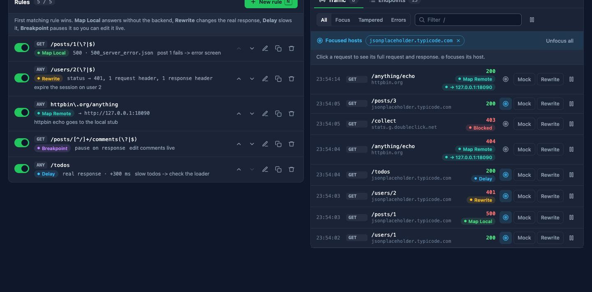
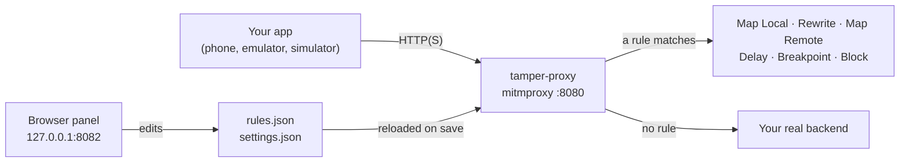
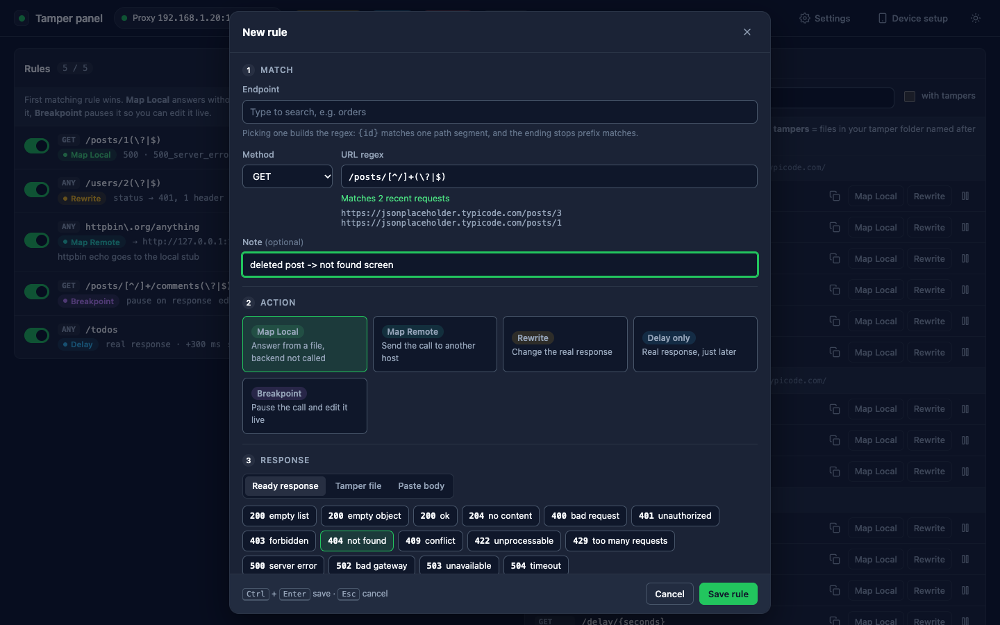
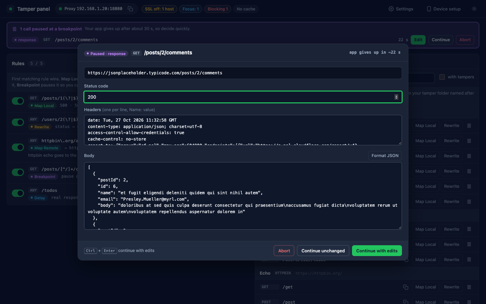
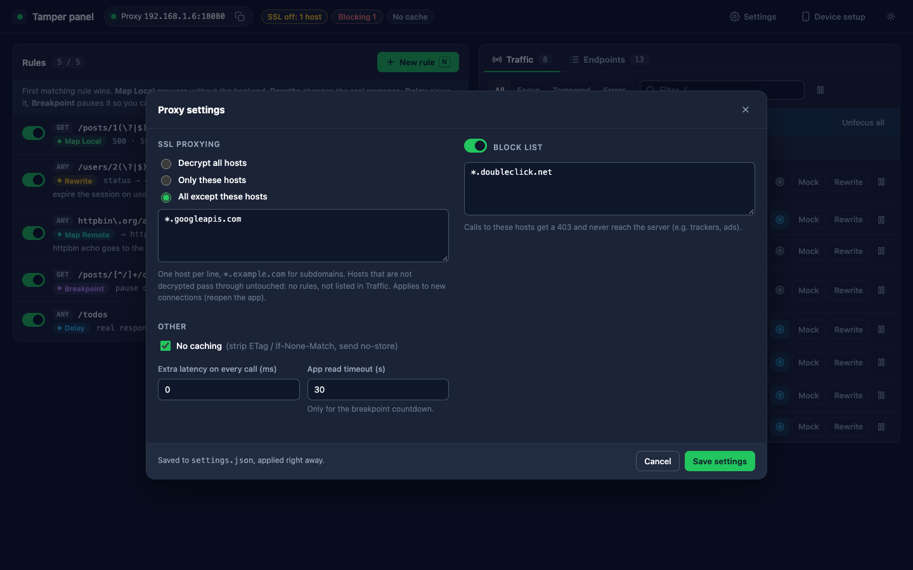
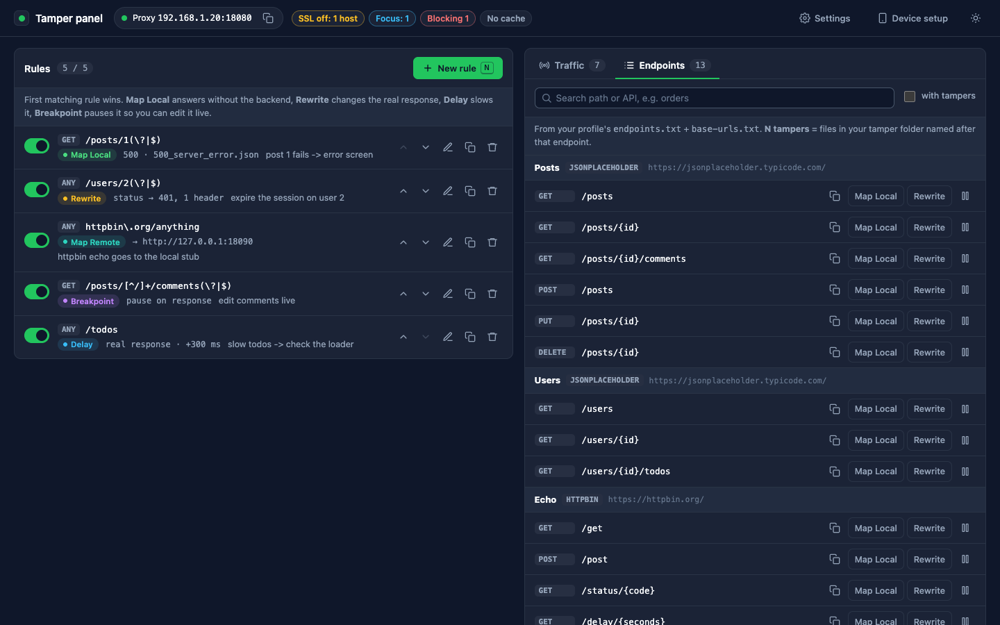

<div align="center">

# tamper-proxy

**A free, open-source alternative to Charles Proxy for mobile developers.**

Mock, rewrite, redirect, slow down or pause your app's HTTP(S) calls from a browser panel,
on Android and iOS. Built on [mitmproxy](https://mitmproxy.org).

[](LICENSE)


[Quick start](#quick-start) ·
[Features](#features) ·
[Your app's folder](#your-apps-folder-profiles) ·
[Devices](#connect-a-device) ·
[AI assistants](#use-it-from-an-ai-assistant) ·
[Slides](docs/presentation.html)



</div>

---

## Quick start

```bash
git clone https://github.com/sherbaev/tamperproxy && cd tamperproxy
bash setup.sh                              # once: a private Python venv with mitmproxy
./proxy.sh --profile profiles/example      # starts the proxy and opens the panel
```

The terminal shows two addresses:

```
Tamper panel   →  http://127.0.0.1:8082     opens in your browser
Device proxy   :  192.168.1.20:8080         set this on the phone (see Connect a device)
```

Stop with **Ctrl+C**. The example profile mocks a public demo API, so you can try every feature
before pointing it at your own app.

## Features

| | Charles | tamper-proxy |
|---|---|---|
| Answer from a local file | Map Local | **Map Local**: ready error bodies, your mock files, or a pasted body |
| Send a call to another host | Map Remote | **Map Remote**: path and query kept |
| Change headers, status, body | Rewrite | **Rewrite**: request headers, response headers, status, find → replace |
| Pause and edit a call live | Breakpoints | **Breakpoint**: edit and continue, abort, or answer with a ready body |
| Slow network | Throttling | Per-rule **Delay** + extra latency on every call |
| Which HTTPS hosts to decrypt | SSL Proxying | **Settings**: all / only these / all except these |
| Show only some hosts | Focus | **◎** on any request in the Traffic list |
| Block hosts | Block List | **Settings → Block list** (answered 403) |
| Disable caching | No Caching | **Settings → No caching** |
| Look inside a call | Structure | **Inspect**: headers, formatted body, *Save response as mock* |
| Your API at a glance | — | **Endpoints** tab: every endpoint and base URL, with your mocks for each |
| Repeatable device checks | — | `run.sh`: mocks + taps + "is this text on screen?" (Android) |
| Works with AI assistants | — | [`SKILL.md`](SKILL.md) / [`AGENTS.md`](AGENTS.md) |
| Price | paid license | **free, MIT** |

Everything you set up is a plain JSON file: easy to read, share with your team, or keep next to a ticket.

## How it works



The panel and the proxy share two files. Change them from the panel, by hand, or from a script:
the proxy picks up the change on the next call, and the panel shows it within seconds.

## Your app's folder (profiles)

A **profile** is one folder that holds everything for one app: its endpoints, base URLs, mock
files, rules and settings. The repo ships a sample; yours lives next to it and is never committed.

```
profiles/
├── example/                  ← sample, shipped with the repo
│   ├── endpoints.txt         your API, grouped:  "# Posts · JSONPLACEHOLDER" then "GET /posts/{id}"
│   ├── base-urls.txt         each group's URL per environment:  JSONPLACEHOLDER  live  https://…
│   ├── mocks/                your mock files (Save response as mock writes here too)
│   ├── rules.sample.json     starting rules, copied to rules.json on the first start
│   └── spec.sample.json      a repeatable Android check for run.sh
│
└── my-app/                   ← yours (git-ignored)
    ├── endpoints.txt
    ├── base-urls.txt
    ├── mocks/
    ├── responses/            optional: error bodies in your backend's own format
    ├── rules.json            created and kept up to date by the panel
    └── settings.json         created and kept up to date by the panel
```

**Make your own:**

```bash
cp -r profiles/example profiles/my-app
rm profiles/my-app/rules.sample.json profiles/my-app/mocks/*   # start clean
# edit profiles/my-app/endpoints.txt and base-urls.txt
./proxy.sh --profile profiles/my-app
```

Already have a folder full of mock files? Add `--library ~/path/to/mocks`: the editor searches it,
and the Endpoints tab shows how many of your files are named after each endpoint.

<details>
<summary><b>endpoints.txt and base-urls.txt format</b></summary>

```text
# endpoints.txt: a "# <Api> · <BASE KEY>" line starts a group; {name} is a path parameter
# Posts · JSONPLACEHOLDER
GET    /posts
GET    /posts/{id}
POST   /posts
```

```text
# base-urls.txt: KEY  environment  URL   (any environment names: dev, staging, prod…)
JSONPLACEHOLDER  live  https://jsonplaceholder.typicode.com/
```

With two or more environments the Endpoints tab shows a button for each.

</details>

## The panel

<table>
<tr>
<td width="50%"></td>
<td width="50%"></td>
</tr>
<tr>
<td><b>Rules.</b> Pick an endpoint or type a regex; the editor shows which recent calls it matches.
First match wins; reorder, switch off, duplicate, delete with Undo.</td>
<td><b>Breakpoints.</b> Pause the request, the response, or both. Edit and continue, abort,
or answer with a ready body, with a countdown until your app gives up.</td>
</tr>
<tr>
<td width="50%"></td>
<td width="50%"></td>
</tr>
<tr>
<td><b>Settings.</b> SSL proxying (all / only / except), Block list, No caching, extra latency,
and your app's read timeout for the breakpoint countdown.</td>
<td><b>Endpoints.</b> Your API from the profile, one click to mock or rewrite any endpoint.</td>
</tr>
</table>

**Focus:** click **◎** on any request to show only its host. Focused hosts appear as chips above
the list; **✕** unfocuses one, **Unfocus all** clears them.

**Shortcuts:** `N` new rule · `/` search traffic · `Ctrl+Enter` save · `Esc` close.

## Connect a device

| Device | Steps |
|---|---|
| **Android phone** | Wi-Fi → your network → Proxy *Manual* → the address (or start with `--adb`). Open `http://mitm.it` → Android → install the certificate. Your debug build's `network_security_config` must trust user certificates. |
| **Android emulator** | A "Google APIs" image + `./proxy.sh cert-emulator` (system certificate, every app trusts it). Proxy host `10.0.2.2`. |
| **iPhone / iPad** | Wi-Fi → (i) → Configure Proxy → *Manual* → the address. Open `http://mitm.it` in Safari → install the profile → **Settings → General → About → Certificate Trust Settings** → full trust. |
| **iOS Simulator** | `./proxy.sh cert-ios-sim` once, then start with `--system-proxy` (the Mac's proxy points here and is restored on Ctrl+C). |

The panel's **Device setup** button shows the same steps with your exact address. When you're
done, switch the device proxy off (`./proxy.sh clear-adb-proxy` for `--adb`).

> Apps must trust user-installed certificates (debug builds) and must not pin certificates.
> That's true for every proxy, Charles included.

<details>
<summary><b>All <code>proxy.sh</code> options</b></summary>

| Option | What it does |
|---|---|
| `--profile DIR` | Your app's folder (endpoints, base URLs, mocks, rules, settings) |
| `--library DIR` | A folder of mock files to search from the editor (repeatable) |
| `--adb [SERIAL]` | Set the Android device's proxy over adb, cleared again on exit |
| `--system-proxy` | macOS: point the Mac's proxy here (iOS Simulator, desktop apps), restored on exit |
| `--port 8080` / `--panel-port 8082` | Other ports |
| `--no-open` | Don't open the browser |
| `--headless` | No panel: only `rules.json` and `settings.json` |
| `--inspector` | Also start mitmproxy's own raw traffic view |
| `cert-emulator` · `cert-ios-sim` · `cert-phone` · `clear-adb-proxy` | Certificate and proxy helpers |

</details>

## Files instead of clicks

The panel writes exactly two files in your profile, and anything else can write them too:

<details open>
<summary><b>rules.json</b></summary>

```json
[
  {"note": "orders fail", "url_regex": "/api/orders(\\?|$)", "methods": ["GET"],
   "action": "map_local", "local_file": "responses/500_server_error.json", "status_code": 500},
  {"note": "empty list", "url_regex": "/api/items(\\?|$)",
   "action": "map_local", "local_file": "mocks/items_empty.json", "status_code": 200},
  {"note": "staging payments", "url_regex": "/api/payments/", "action": "map_remote",
   "target": "https://staging.example.com"},
  {"note": "expire the session", "url_regex": "/api/profile", "action": "rewrite",
   "rewrite": {"status_code": 401, "request_headers": {"Authorization": "Bearer expired"},
               "headers": {"Cache-Control": "no-store"}, "body_replace": []}},
  {"note": "edit the cart live", "url_regex": "/api/cart", "action": "breakpoint", "pause_on": "response"},
  {"note": "slow search", "url_regex": "/api/search", "action": "delay", "delay_ms": 3000}
]
```

Relative `local_file` paths start from your profile folder; `responses/…` also finds the
15 built-in bodies (200 / 204 / 400 / 401 / 403 / 404 / 409 / 422 / 429 / 500 / 502 / 503 / 504).

</details>

<details>
<summary><b>settings.json</b></summary>

```json
{"ssl": {"mode": "except", "hosts": ["*.googleapis.com"]},
 "focus": {"enabled": true, "hosts": ["api.example.com"]},
 "block": {"enabled": true, "hosts": ["*.analytics.example"]},
 "no_cache": true, "latency_ms": 0, "app_timeout_s": 30}
```

Host patterns: `api.example.com`, `*.example.com` (subdomains), `*`.

</details>

Every tampered call is logged in `logs/served.jsonl` (mocked, rewritten, redirected, delayed or
blocked, with the status the app received); untouched calls go to `logs/unmatched.jsonl`.

## Use it from an AI assistant

[`SKILL.md`](SKILL.md) teaches Claude Code, and through [`AGENTS.md`](AGENTS.md) other coding
assistants (Copilot, Cursor…), to use tamper-proxy instead of Charles: start it, find the
endpoint, write the rule, change settings, then prove the mock was served from
`logs/served.jsonl`. Everything an assistant does shows up live in the panel.

To install it as a Claude Code skill, link the repo into `~/.claude/skills/tamper-proxy`.

## Repeatable checks (Android)

`run.sh` starts the proxy with a spec's mocks, sets the device proxy, drives the app with
[uiautomator2](https://github.com/openatx/uiautomator2), checks the screen **and** that the mock
was really served, then always cleans up.

```bash
"$HOME/.cache/tamper-proxy-venv/bin/python" -m uiautomator2 init   # once per device
./run.sh --spec profiles/example/spec.sample.json
```

Format: [`profiles/example/spec.sample.json`](profiles/example/spec.sample.json) and
[`lib/spec.schema.json`](lib/spec.schema.json).

## Troubleshooting

| Symptom | Fix |
|---|---|
| No traffic | Check the device proxy address. On a VPN your computer may have two IPs: `TAMPER_PROXY_HOST=<wifi ip> ./proxy.sh` |
| HTTPS errors in the app | Certificate not installed or not trusted (iOS: Certificate Trust Settings), a release build, or certificate pinning |
| A host is missing from Traffic | Excluded in Settings → SSL proxying, or blocked |
| A mock answers 502 "mock file missing" | Wrong `local_file` path (relative paths start from the profile folder) |
| Breakpoint never pops up | The rule is off, its regex doesn't match, or a Map Local rule above answers first |
| A host fails over HTTP/2 | `TAMPER_MITM_OPTS="--set http2=false" ./proxy.sh` |
| "Address already in use" | Another copy is running, or use `--port` / `--panel-port` |
| "The proxy was restarted" banner | The tab is from a previous run: click **Reload** |

## Security

- The panel listens on `127.0.0.1` only. Its API needs a per-run token and a local `Host` header,
  so other websites can't drive it. Breakpoint edits can't inject headers.
- The panel reads files only from `responses/`, your profile's `mocks/` and `--library` folders.
- Logs keep scheme + host + path only (no query values). Request details for Inspect stay in
  memory (last 300 calls).
- The proxy port listens on your network so devices can reach it: use it on networks you trust.

## Development

```bash
~/.cache/tamper-proxy-venv/bin/python tests/test_toolkit.py     # or: pytest tests/
```

The panel is plain HTML/CSS/JS with no build step (`lib/panel*`), served by `lib/panel.py`.
The proxy logic is a mitmproxy addon, `lib/tamper_addon.py`.

## License

MIT, see [LICENSE](LICENSE). Built on [mitmproxy](https://github.com/mitmproxy/mitmproxy) (MIT).
Charles is a trademark of XK72 Ltd; tamper-proxy is an independent project, not affiliated with
or endorsed by it.
